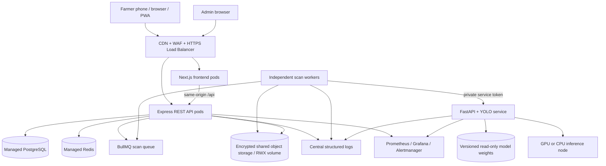
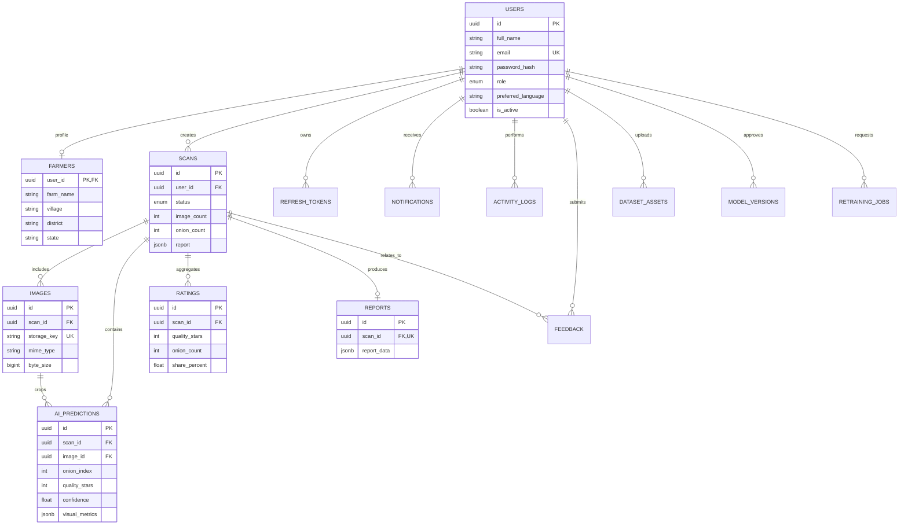

# Architecture and data model

## Production architecture diagram

The supplied Compose deployment uses a shared named upload volume and one AI service. In Kubernetes, API and worker pods share a ReadWriteMany PVC for uploads; choose EFS, Azure Files or Filestore, or replace the filesystem storage adapter with an audited object-storage implementation. Use managed PostgreSQL and Redis for high-availability production deployments.

## Request flow

1. The authenticated farmer sends up to 30 supported images to `POST /api/scans`.
2. The API validates per-file type signatures, extension-independent MIME sniffing, file/batch size, ownership and user role. It saves images with random storage keys and creates `scans`/`images` records in PostgreSQL.
3. A BullMQ job is enqueued in Redis and the API returns `202 Accepted` with a scan ID. The web page polls `GET /api/scans/:id` for status.
4. A worker retrieves all scan images, makes one private authenticated batch call to the FastAPI AI service and handles retries with exponential backoff.
5. The AI service detects onion bulbs, extracts crops, classifies each crop into a 1–5-star grade and calculates image descriptors. If the detector includes trained defect classes, visible defects inside an onion bounding box are also flagged.
6. The worker transactionally writes predictions, quality distribution, report JSON and farmer notification, then marks the scan completed. On exhausted retries it records a safe failure message.
7. The farmer sees the score, confidence, grade distribution, indicator values, reasoning and CSV export. No price is calculated or displayed.

## Performance and scale

- Upload and scan creation are separated from inference through Redis/BullMQ so API replicas are not tied to GPU time.
- The worker sends a batch to AI. The inference service batches detector inputs and classifier crops. One model process per AI pod avoids duplicate GPU memory use; scale pods against measured queue depth and GPU utilization.
- Add object storage, asynchronous lifecycle policies for original images, CDN for static frontend assets, database connection-pool sizing and partition/retention rules as data volume grows.
- For 100+ onions in seconds, tune `max_det`, image resolution, batch size, GPU model, model architecture and concurrency against benchmark lots. Bigger requests should be split or handled by a long-lived async job, not allowed to monopolize an API request.
- The target 99.9% service availability requires multi-zone managed services, health-based load balancing, zero-downtime migrations, tested backups and incident procedures. A single local Compose stack cannot provide that SLO.

## ER diagram

## Database principles

- UUID primary keys prevent sequential IDs from becoming public identifiers. Every farmer read is scoped by `user_id`.
- Images live in persistent storage, not in PostgreSQL blobs. The database stores storage keys, detected counts, model versions and metadata.
- `ai_predictions` preserves per-onion bounding boxes, grade, confidence and visible indicators for review and future auditing.
- `reports` and `scans.report` contain the aggregate report JSON for fast dashboard retrieval. `ratings` stores a small grouped distribution table.
- Add retention/erasure jobs for user data and uploaded imagery according to consent, regulatory needs and the pilot agreement.
